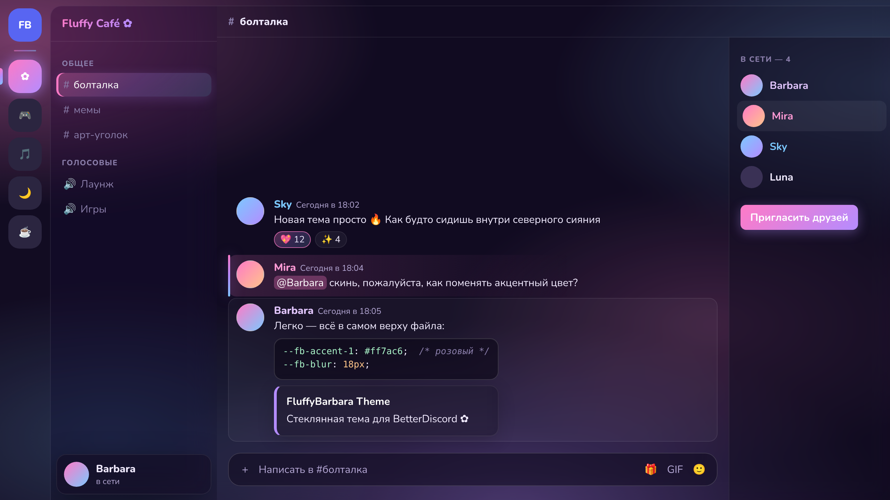

# FluffyBarbara ✿ — тема для BetterDiscord

Нежная «стеклянная» тема: анимированное розово-лавандовое сияние на фоне, полупрозрачные панели с размытием, градиентные акценты и плавные анимации.



## Что внутри

- 🌌 Анимированный фон-сияние (или своя картинка)
- 🧊 Стеклянные панели с размытием: каналы, чат, участники, меню, модальные окна
- 🌈 Градиентные кнопки, бейджи, выбранные каналы, скроллбары, полоска упоминаний
- ✨ Плавное появление сообщений и меню, подсветка аватарок при наведении
- 💬 Поле ввода-«таблетка» со свечением при фокусе
- 🎨 Подсветка синтаксиса в блоках кода
- 🔤 Шрифт Nunito (с кириллицей)
- ♿ Анимации отключаются, если в системе или Discord включено «уменьшить движение»

## Установка

1. Установи [BetterDiscord](https://betterdiscord.app/).
2. Скачай файл [`FluffyBarbara.theme.css`](FluffyBarbara.theme.css).
3. В Discord: **Настройки → BetterDiscord → Темы → Открыть папку тем**.
4. Положи туда файл и включи тему переключателем.

## Настройка

Все настройки — в самом верху файла, в блоке `:root`:

| Переменная | Что меняет | По умолчанию |
|---|---|---|
| `--fb-accent-1/2/3` | цвета градиента | розовый / лавандовый / небесный |
| `--fb-background-image` | своя картинка на фон, например `url("https://…/bg.jpg")` | `none` (сияние) |
| `--fb-background-dim` | затемнение картинки, `0`–`1` | `0.35` |
| `--fb-blur` | сила размытия (`0px` — выключить, если Discord тормозит) | `18px` |
| `--fb-glass` | прозрачность панелей, `0`–`1` | `0.38` |
| `--fb-radius` | скругление панелей | `16px` |
| `--fb-animation` | анимация фона: `running` / `paused` | `running` |
| `--fb-font` | шрифт | `Nunito` |

Пример — мятно-фиолетовая версия:

```css
--fb-accent-1: #7dffcf;
--fb-accent-2: #a07cff;
--fb-accent-3: #6ad7ff;
```

## Лицензия

[MIT](LICENSE)
